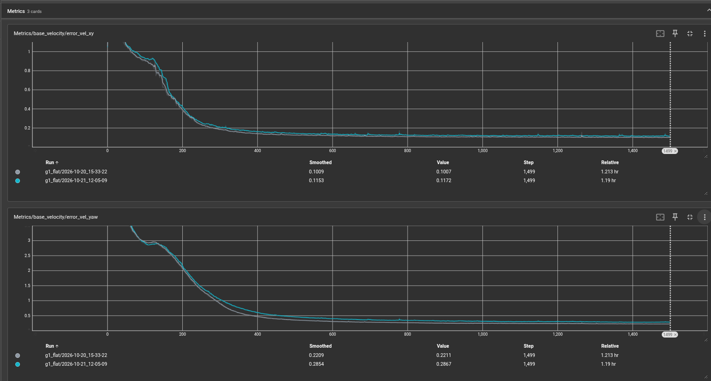
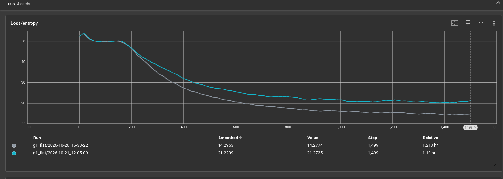
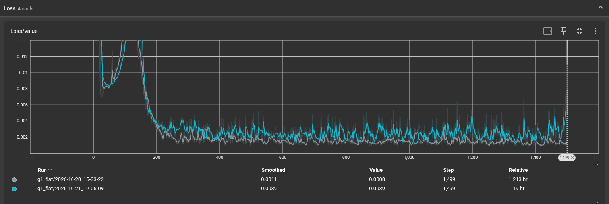
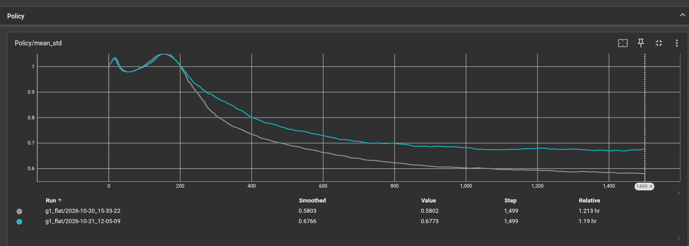

# Unitree G1 Locomotion with Domain Randomization (Isaac Lab)
Training a robust PPO locomotion policy for the Unitree G1 humanoid with custom domain randomization for Sim2Real transfer.

## Overview
This project trains a reinforcement learning (PPO) locomotion policy for the Unitree G1 humanoid robot using NVIDIA Isaac Lab. The primary goal is to improve Sim2Real transfer by implementing domain randomization on key physical parameters.

The baseline task (Isaac-Velocity-Flat-G1) was modified to introduce variations in actuator gains, surface friction, and base mass during training. By exposing the policy to a range of physical dynamics in simulation, the resulting controller is more robust to the uncertainties of real-world deployment.

## Modifications (Domain Randomization)

To improve Sim2Real robustness, I expanded the baseline domain randomization parameters to better reflect real-world physical uncertainties:

*   **Actuator Gains:** Added `randomize_actuator_gains` with a ±25% variance on stiffness and damping. This simulates the noisy torque responses and manufacturing inconsistencies of real humanoid actuators.
*   **Friction:** Shifted the fixed physics material values to a randomized distribution (`static`: 0.5–1.0, `dynamic`: 0.4–0.8). This mimics genuine surface variations rather than a single ideal uniform state.
*   **Base Mass:** Tightened the distribution to `(0.85, 1.2)` from the default `(1.0, 1.25)`. This centers the mass closer to the nominal value while keeping the tails to account for sensor payload variations.

## Training Commands
To begin training with the updated parameters, please move the corresponding velocity_env_cfg.py to the velocity section of the IsaacLab folder at:
/IsaacLab/source/isaaclab_tasks/isaaclab_tasks/core/velocity/

* Please note that the exact location may change depending on your specific version of IsaacLab.

Once the velocity_env_cfg.py file has been moved to the correct location, you could run the training via the following command:

'''
$ isaaclab train --rl_library rsl_rl --task Isaac-Velocity-Flat-G1 --num_envs 4096
'''

Any artifacts from the training including checkpoints should now be at:
/logs/rsl_rl/g1_flat/<timestamp>/

In order to then export the resulting policy, please run:

'''
$ isaaclab -p scripts/reinforcement_learning/play.py --task Isaac-Velocity-Flat-G1 --num_envs 32 --checkpoint logs/rsl_rl/g1_flat/<timestamp>/model_<checkpoint_num>.pt
'''

Aside from a nice rendering of the robot, you should see three artifacts at: logs/rsl_rl/g1_flat/<timestamp>/exported/

1) policy.onnx
2) policy.onnx.data
3) policy.pt

## Results

### Training Velocity Error

### Training Loss Entropy 

### Training Loss Value

### Training Policy Standard Deviation

